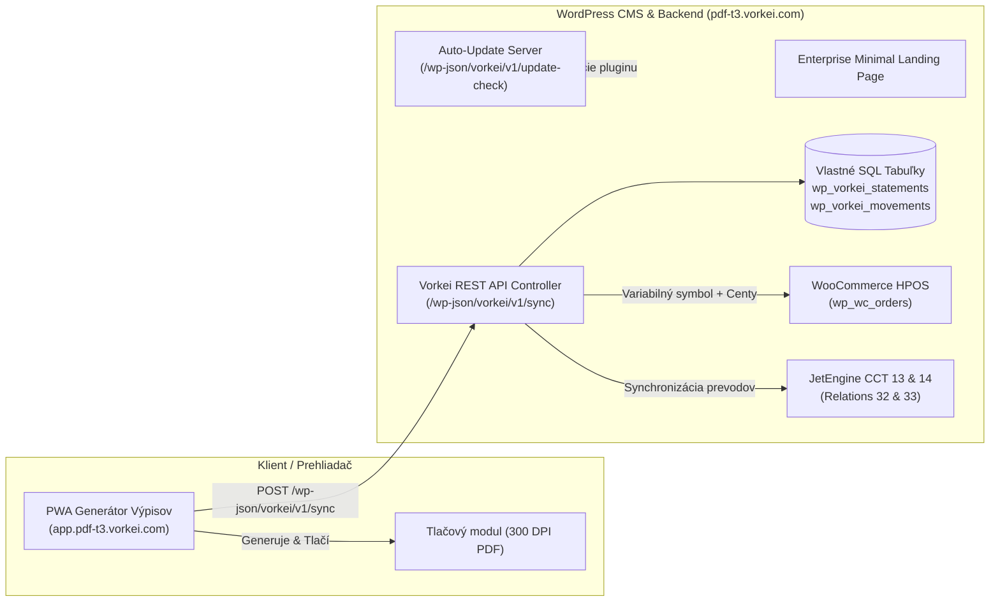

# 🏛️ Tatra Banka PDF Statement Generator & Vorkei Statement Bridge

<div align="center">

[](https://react.dev)
[](https://tanstack.com)
[](https://www.typescriptlang.org)
[](https://tailwindcss.com)
[](https://wordpress.org)
[](https://woocommerce.com)
[](docs/DEVELOPER_GUIDE.md)

**Profesionálny fintech ekosystém pre generovanie a tlač bankových výpisov Tatra banky v 300 DPI kvalite a ich automatické párovanie s WooCommerce objednávkami cez WordPress REST API.**

[🌐 Živá aplikácia (PWA)](https://app.pdf-t3.vorkei.com/) • [🚀 Landing & CMS](https://pdf-t3.vorkei.com/) • [📦 Stiahnuť Plugin ZIP](https://pdf-t3.vorkei.com/wp-content/uploads/2026/10/vorkei-statement-bridge.zip) • [📘 Vývojárska príručka](docs/DEVELOPER_GUIDE.md)

</div>

---

## 📑 Obsah

- [Prehľad Projektu](#-prehľad-projektu)
- [Produkčná Architektúra (Dual-Domain)](#-produkčná-architektúra-dual-domain)
- [PWA Statement Generator (Generátor Výpisov)](#-pwa-statement-generator-generátor-výpisov)
- [Vorkei Statement Bridge (WordPress Plugin)](#-vorkei-statement-bridge-wordpress-plugin)
- [Štruktúra Repozitára](#-štruktúra-repozitára)
- [Rýchly Štart pre Vývojárov (Quickstart)](#-rýchly-štart-pre-vývojárov-quickstart)
- [REST API Rozhranie](#-rest-api-rozhranie)
- [Bezpečnosť, GDPR a Finančná Integrita](#-bezpečnosť-gdpr-a-finančná-integrita)
- [11-Úrovňová Testovacia Pyramída](#-11-úrovňová-testovacia-pyramída)
- [Dokumentácia a Zdroje](#-dokumentácia-a-zdroje)
- [Licencia](#-licencia)

---

## 🌟 Prehľad Projektu

Tento projekt rieši zásadný problém malých a stredných e-shopov: **manuálne prepisovanie variabilných symbolov z bankových výpisov**. Bankové API (Premium PSD2) bývajú extrémne nákladné (desiatky až stovky eur mesačne) a vyžadujú zložité certifikáty.

Náš ekosystém ponúka **100% on-premise alternatívu**:
1. **Klientská PWA Aplikácia (`app.pdf-t3.vorkei.com`)**: Generovanie, úprava a tlač bankových výpisov Tatra banky s mikrogenealógiou, bezpečnostným PIN kódom a A4 rozložením pri 300 DPI.
2. **WordPress Bridge Plugin (`pdf-t3.vorkei.com`)**: Príjem bankových dát cez zabezpečené REST API, kryptografická deduplikácia (SHA-256), zápis do vlastných tabuliek a okamžité automatické spárovanie s **WooCommerce HPOS** objednávkami a **JetEngine CCT**.

---

## 🏗️ Produkčná Architektúra (Dual-Domain)

Celý systém funguje na oddelených, vysoko optimalizovaných doménach:



---

## 🖨️ PWA Statement Generator (Generátor Výpisov)

Webová aplikácia beží na adrese **`https://app.pdf-t3.vorkei.com/`** a ponúka špičkový klientsky komfort:

- **Vernosť originálu Tatra banky**:
  - Autentické fonty, zarovnania a rozloženie tabuliek.
  - Dynamická viacstranová paginácia s opakovaním hlavičky a medzisúčtov (*Prenos zostatku z predchádzajúcej strany* / *Pokračovanie na nasledujúcej strane*).
  - Tlačový štýl optimalizovaný pre presný formát **A4 na výšku (300 DPI)**.
- **Bezpečnostná mikrogenealógia a vodoznak**:
  - Generovanie unikátneho vodoznaku s PIN kódom (napr. `PIN: 23513900`).
  - Dvojitý kontrolný odtlačok integrity dokumentu.
- **Striktná finančná matematika v centoch**:
  - Všetky výpočty pracujú s celočíselnými centami (`cents: number`), čo zaručuje nulovú chybu pri zaokrúhľovaní.
  - Okamžitá validácia: `Počiatočný zostatok + Prijaté platby - Odoslané platby = Konečný zostatok`.
- **Offline & PWA Ready**:
  - Web App Manifest v `public/manifest.webmanifest`.
  - Možnosť inštalácie na plochu v iOS (Safari), Android (Chrome) aj desktope.
  - Lokálne ukladanie rozpracovaných výpisov bez nutnosti pripojenia.

---

## 🔌 Vorkei Statement Bridge (WordPress Plugin)

Oficiálny WordPress plugin je dostupný v adresári [`vorkei-statement-bridge/`](vorkei-statement-bridge/):

- **WooCommerce HPOS Native**: Plná kompatibilita s `Automattic\WooCommerce\Utilities\FeaturesUtil::declare_compatibility( 'custom_order_tables' )`.
- **Inteligentné párovanie objednávok**:
  - Dohľadanie objednávky podľa Variabilného symbolu (VS) z platby.
  - Podpora pre vstavané ID objednávok aj zákazkové čísla (Sequential / Custom Order Numbers, SuperFaktúra, WooCommerce PDF Invoices).
  - Striktná kontrola centov zabraňuje falošnému označeniu podplatenej objednávky za zaplatenú.
  - Automatická zmena stavu objednávky (napr. `pending` -> `processing`) a zápis auditu do privátnej poznámky.
- **JetEngine CCT Integrácia**:
  - **CCT 13: `wp_jet_cct_bank_statements`** (Hlavičky výpisov).
  - **CCT 14: `wp_jet_cct_transfers`** (Finančné pohyby naviazané na CCT Zákazníkov a Dodávateľov).
  - **Relácie v `wp_jet_rel_default`**: Relácia 32 (Klient -> Výpisy) a Relácia 33 (Banka -> Výpisy).
- **Vstavaný Auto-Update Server**:
  - Integrovaný klient pre aktualizácie na jeden klik priamo v administračnom paneli WordPress cez endpoint `/wp-json/vorkei/v1/update-check`.
- **100% On-Premise**:
  - Žiadne bankové transakcie neopúšťajú váš server.

---

## 📁 Štruktúra Repozitára

```text
pdf-t3-vorkei/
├── src/                          # Zdrojový kód Next-gen PWA aplikácie (React 19)
│   ├── components/               # UI komponenty, tlačový engine, formuláre výpisov
│   │   ├── vypis-app.tsx         # Hlavný stavový orchester PWA aplikácie
│   │   ├── print-view.tsx        # 300 DPI tlačový layout výpisu Tatra banky
│   │   └── statement-editor.tsx  # Editácia hlavičky, IBANu a pohybov
│   ├── lib/                      # Finančná logika, centová aritmetika, validátory
│   ├── routes/                   # TanStack Router trasy (__root.tsx, index.tsx)
│   └── styles.css                # Tailwind CSS v4 design tokens a tlačové médiá
├── vorkei-statement-bridge/      # WordPress Plugin (PHP 8.1+)
│   ├── admin/                    # Administračné rozhranie a nastavenia pluginu
│   ├── assets/                   # Ikony a bannery pre WordPress modál
│   ├── includes/                 # Jadro pluginu
│   │   ├── class-vorkei-activator.php       # SQL tabuľky cez dbDelta
│   │   ├── class-vorkei-matcher.php         # Párovanie WooCommerce HPOS objednávok
│   │   ├── class-vorkei-rest-controller.php # REST API (/sync, /statements, /movements)
│   │   └── class-vorkei-updater.php         # WordPress auto-updater klient
│   ├── tests/                    # 11-úrovňová testovacia pyramída
│   ├── readme.txt                # Oficiálny WordPress.org formát
│   └── vorkei-statement-bridge.php # Hlavný zavádzač pluginu
├── docs/                         # Podrobná technická dokumentácia
│   ├── DEVELOPER_GUIDE.md        # Kompletná integračná príručka pre vývojárov
│   └── SOURCE_OF_TRUTH.md        # Produkčné konfigurácie, prístupy a CCT mapovanie
├── scripts/                      # Automatizačné skripty, testy a nasadzovanie
│   ├── deploy-landing-wp.py      # Nasadenie landing page na WordPress REST API
│   └── browser-smoke.mjs         # Headless browser smoke testy (Playwright)
├── public/                       # Statické prostriedky, ikony, PWA manifest
├── vercel.json                   # Konfigurácia produkčného Vercel hostingu
├── startup.sh                    # Idempotentný štartovací skript pre sandbox prostredie
├── tsconfig.json                 # TypeScript striktná konfigurácia
└── package.json                  # Node.js závislosti a skripty (pnpm)
```

---

## 🚀 Rýchly Štart pre Vývojárov (Quickstart)

### Požiadavky:
- **Node.js**: v22 LTS (odporúčané `22.22.1`)
- **Balíčkovač**: `pnpm` (v12+)
- **Python**: v3.14 (s nástrojom `uv` pre pomocné skripty)

> [!IMPORTANT]
> V tomto projekte sa striktne používa `pnpm` pre Node.js a `uv` pre Python. Nikdy neinštalujte balíčky globálne cez `npm -g` ani nepoužívajte `sudo pip`.

### 1. Klonovanie a inštalácia závislostí
```bash
# Klonovanie repozitára
git clone https://github.com/vorkei-com/pdf-t3-vorkei.git
cd pdf-t3-vorkei

# Inštalácia závislostí cez pnpm
pnpm install
```

### 2. Spustenie lokálneho vývojového servera
```bash
# Spustí Vite dev server na http://0.0.0.0:8080 s HMR
pnpm dev
```
Otvorte si v prehliadači [http://localhost:8080](http://localhost:8080).

### 3. Kontrola typov a zostavenie (Build)
```bash
# TypeScript kontrola bez emitovania súborov
pnpm typecheck

# Produkčný build (Nitro + Vite)
pnpm build
```

### 4. Spustenie testov
```bash
# Spustenie automatických jednotkových a integračných testov
node --test 'scripts/**/*.test.mjs'
```

---

## 🔌 REST API Rozhranie

| Metóda | Trasa | Popis |
| :--- | :--- | :--- |
| `POST` | `/wp-json/vorkei/v1/sync` | Príjem výpisov, deduplikácia SHA-256 a okamžité párovanie s Woo |
| `GET` | `/wp-json/vorkei/v1/statements` | Zoznam synchronizovaných výpisov s pagináciou |
| `GET` | `/wp-json/vorkei/v1/statements/{id}` | Detail konkrétneho bankového výpisu |
| `GET` | `/wp-json/vorkei/v1/movements` | Zoznam transakcií (podpora filtrovania podľa `variable_symbol`) |
| `GET/POST`| `/wp-json/vorkei/v1/update-check` | Kontrola verzií a sťahovanie aktualizácií pre WordPress |

> 📘 Kompletné príklady požiadaviek a JSON schém nájdete v [Developer Guide](docs/DEVELOPER_GUIDE.md#5-rest-api-špecifikácia).

---

## 🛡️ Bezpečnosť, GDPR a Finančná Integrita

1. **Bank Secret & GDPR Safe**: Všetky citlivé dáta ostávajú výhradne v databáze vášho e-shopu. Žiadne transakčné údaje neodchádzajú do externých SaaS riešení tretích strán.
2. **Kryptografické hashovanie**: Transakcie sú deduplikované pomocou SHA-256 hashu. Ani opakovaný import rovnakého výpisu nevytvorí duplicitné platby.
3. **Celočíselná aritmetika v centoch**: Žiadne nepresnosti spôsobené typom `float`. Finančné zostatky sú kontrolované na cent presne.
4. **Dvojitá autorizácia**: Podpora natívnych WordPress Application Passwords a voliteľného tajného Bearer Tokenu.

---

## 🧪 11-Úrovňová Testovacia Pyramída

Architektúra pluginu a integračného mosta je chránená 11 úrovňami testov:

```text
Level 11: Auto-Updates & PclZip Package Integrity (PASS)
Level 10: E2E PWA Contract Verification (PASS)
Level 09: Fintech Multi-Currency & Cent Integrity (PASS)
Level 08: Chaos & Resilience Testing (PASS)
Level 07: Security & Pentesting (SQLi, XSS) (PASS)
Level 06: Stress & Concurrency Deduplication (PASS)
Level 05: WooCommerce HPOS Order Matching (PASS)
Level 04: REST API Routes & Auth Schemes (PASS)
Level 03: SQL Schema Integrity via dbDelta (PASS)
Level 02: Bootstrap & HPOS Declarations (PASS)
Level 01: PHP Syntax & Coding Standards (PASS)
```

---

## 📚 Dokumentácia a Zdroje

- 📘 [WordPress Developer & Integration Guide](docs/DEVELOPER_GUIDE.md) — Podrobný manuál pre vývojárov, hooks, filtre a príklady v PHP.
- 📜 [Source of Truth & Production Architecture](docs/SOURCE_OF_TRUTH.md) — Architektúra nasadenia, produkčné credentials a mapovanie CCT tabuliek.
- 📦 [Vorkei Statement Bridge Plugin README](vorkei-statement-bridge/README.md) — Prehľad samotného pluginu.
- 🌐 [Oficiálna stránka a dokumentácia](https://vorkei.com)

---

## 📄 Licencia

- **PWA Frontend & Webová aplikácia**: Copyright © 2026 Vorkei. Všetky práva vyhradené.
- **Vorkei Statement Bridge (WordPress Plugin)**: Šírený pod licenciou **GNU General Public License v2 alebo novšou (GPLv2+)**.

---

<div align="center">
Vytvorené s precíznosťou pre <strong>Tatra banka</strong> a <strong>WooCommerce HPOS</strong> • 2026 <a href="https://vorkei.com">vorkei.com</a>
</div>
