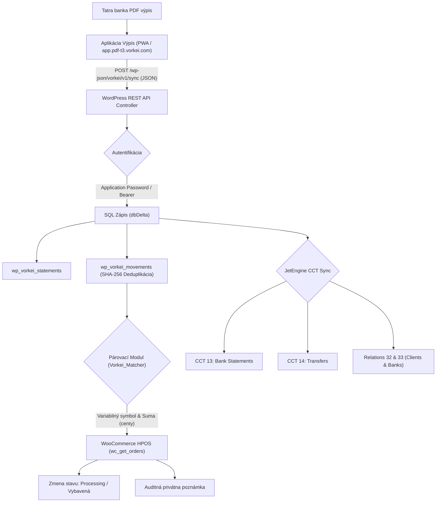

# 🛠️ Vorkei Statement Bridge — WordPress Developer & Integration Guide

> **Oficiálna vývojárska a integračná príručka pre WordPress, WooCommerce HPOS a JetEngine CCT.**
> Verzia pluginu: **1.0.0** | WordPress: **6.2 až 6.7+** | PHP: **8.1 - 8.4** | WooCommerce HPOS: **Kompatibilný**

---

## 📑 Obsah

1. [Prehľad a Architektúra](#1-prehľad-a-architektúra)
2. [Systémové požiadavky](#2-systémové-požiadavky)
3. [Možnosti inštalácie](#3-možnosti-inštalácie)
4. [Konfigurácia a Autentifikácia](#4-konfigurácia-a-autentifikácia)
5. [REST API Špecifikácia](#5-rest-api-špecifikácia)
6. [Databázová schéma a JetEngine CCT](#6-databázová-schéma-a-jetengine-cct)
7. [Akcie a Filtre (Hooks & Filters API)](#7-akcie-a-filtre-hooks--filters-api)
8. [Automatické aktualizácie (Auto-Update Server)](#8-automatické-aktualizácie-auto-update-server)
9. [11-Úrovňová Testovacia Pyramída](#9-11-úrovňová-testovacia-pyramída)
10. [Riešenie problémov (Troubleshooting)](#10-riešenie-problémov-troubleshooting)

---

## 1. Prehľad a Architektúra

`vorkei-statement-bridge` je robustný WordPress plugin vyvinutý pre automatizáciu spracovania bankových výpisov (primárne **Tatra banka PDF výpisy**) a ich okamžité spárovanie s **WooCommerce objednávkami** a **JetEngine Custom Content Types (CCT)**.



### Kľúčové architektonické piliere:
- **100% On-Premise & GDPR Safe**: Žiadne bankové údaje neodchádzajú do externého cloudu. Celý proces prebieha na vašom WordPress hostingu.
- **HPOS Native**: Deklarovaná kompatibilita s High-Performance Order Storage (`custom_order_tables`).
- **Centová finančná matematika**: Sumy sú interne ukladané a porovnávané striktne ako celé čísla v centoch (`amount_cents: int`), čím sa eliminuje nepresnosť desatinných čísel (floating-point rounding errors).
- **Kryptografická deduplikácia**: Každý pohyb má unikátny SHA-256 hash odvodený z `date + amount_cents + party_iban + variable_symbol + statement_id`. Opakované odoslanie výpisu nespôsobí duplicitné platby ani falošné párovania.

---

## 2. Systémové požiadavky

| Komponent | Minimálna požiadavka | Odporúčaná verzia |
| :--- | :--- | :--- |
| **WordPress** | 6.2 | **6.7+** |
| **PHP** | 8.1 | **8.2 / 8.3** |
| **MySQL / MariaDB** | MySQL 5.7 / MariaDB 10.4 | MySQL 8.0+ / MariaDB 10.6+ |
| **WooCommerce** | 8.0+ | **9.0+ (HPOS povolené)** |
| **JetEngine (voliteľné)** | 3.1+ | 3.5+ (pre CCT integráciu) |
| **PHP Rozšírenia** | `json`, `hash`, `pcre` | `opcache`, `mbstring` |

---

## 3. Možnosti inštalácie

### Možnosť A: Nahratie ZIP balíčka cez WP Admin (Najjednoduchšie)
1. Stiahnite inštalačný balíček `vorkei-statement-bridge.zip` (z [vorkei.com](https://pdf-t3.vorkei.com/wp-content/uploads/2026/10/vorkei-statement-bridge.zip) alebo z tohto repozitára).
2. Vo WordPress administrácii prejdite na **Pluginy -> Pridať nový -> Nahrať plugin**.
3. Vyberte súbor `vorkei-statement-bridge.zip` a kliknite na **Inštalovať teraz**.
4. Po dokončení inštalácie kliknite na **Aktivovať plugin**.

### Možnosť B: Git Clone do `wp-content/plugins` (Pre vývojárov)
```bash
cd /cesta/k/wordpress/wp-content/plugins/
git clone https://github.com/vorkei-com/pdf-t3-vorkei.git
# Alebo skopírujte len samotný plugin priečinok:
cp -r /cesta/k/pdf-t3-vorkei/vorkei-statement-bridge ./vorkei-statement-bridge
```

### Možnosť C: Inštalácia cez WP-CLI
```bash
# Inštalácia priamo zo ZIP archívu
wp plugin install /cesta/k/vorkei-statement-bridge.zip --activate

# Overenie stavu
wp plugin status vorkei-statement-bridge
```

Pri aktivácii plugin automaticky spustí `Vorkei_Activator::activate()`, ktorý vytvorí vlastné SQL tabuľky cez WordPress `dbDelta()`.

---

## 4. Konfigurácia a Autentifikácia

### Nastavenia v administrácii WordPress
Po aktivácii nájdete v bočnom menu sekciu **Vorkei Bridge -> Nastavenia**:
- **Cieľový stav spárovanej objednávky**: Určuje, na aký stav sa má objednávka zmeniť po prijatí platby (`processing` [Spracováva sa], `completed` [Vybavená], alebo `none` [Žiadna zmena]).
- **Striktná kontrola sumy**: Ak je zapnutá, platba sa spáruje len vtedy, ak sa prijatá suma v centoch presne rovná sume objednávky. Pri nedoplatku alebo preplatku plugin pridá varovnú poznámku a ponechá objednávku na manuálnu kontrolu.
- **Auditná poznámka k objednávke**: Zapína/vypína pridávanie privátnej systémovej poznámky s podrobnosťami o platbe (dátum, IBAN odosielateľa, číslo výpisu).
- **Emailové notifikácie o nezrovnalostiach**: Automaticky odošle email administrátorovi eshopu, ak variabilný symbol existuje, ale suma platby nesedí.

### Zabezpečenie a Autentifikácia REST API

Plugin podporuje dva spôsoby autorizácie požiadaviek:

#### 1. WordPress Application Passwords (Odporúčané štandardné riešenie)
1. Prejdite na **Používatelia -> Váš profil**.
2. V sekcii **Aplikačné heslá** zadajte názov aplikácie (napr. `Vorkei Sync App`) a kliknite na **Pridať nové aplikačné heslo**.
3. Vygenerované heslo (v tvare `xxxx xxxx xxxx xxxx xxxx xxxx`) skopírujte.
4. Použite HTTP Basic autentifikáciu:
   ```http
   Authorization: Basic <base64(používateľské_meno:aplikačné_heslo)>
   ```

#### 2. Vlastný Secret Bearer API Token
1. Prejdite na **Vorkei Bridge -> Nastavenia -> Zabezpečenie**.
2. Zadajte vlastný alfanumerický token (napr. dlhý náhodný 32+ miestny reťazec).
3. Uložte nastavenia. Požiadavky potom môžu používať hlavičku:
   ```http
   Authorization: Bearer <váš_tajný_token>
   ```

---

## 5. REST API Špecifikácia

Všetky endpointy sú registrované pod menným priestorom `vorkei/v1`.

### 1. Synchronizácia výpisu a pohybov (`POST /wp-json/vorkei/v1/sync`)

Tento endpoint prijíma JSON s dátami jedného alebo viacerých výpisov a transakcií.

- **URL:** `https://vas-eshop.sk/wp-json/vorkei/v1/sync`
- **Metóda:** `POST`
- **Hlavičky:**
  - `Content-Type: application/json`
  - `Authorization: Basic <base64>` **alebo** `Authorization: Bearer <token>`

#### Príklad tela požiadavky (Request Body):
```json
{
  "account": {
    "iban": "SK8811000000002941234567"
  },
  "statements": [
    {
      "id": "tb-2026-10-29",
      "number": "210",
      "period": "28.10.2026 - 29.10.2026",
      "openingCents": 1254000,
      "closingCents": 1443500,
      "currency": "EUR",
      "issuedOn": "29.10.2026",
      "movements": [
        {
          "id": "mv-20261029-001",
          "date": "29.10.2026",
          "amountCents": 18950,
          "kind": "in",
          "partyName": "Peter Novák",
          "partyIban": "SK1211000000002612345678",
          "variableSymbol": "1042",
          "specificSymbol": "",
          "constantSymbol": "0308",
          "note": "Úhrada za tovar - objednávka 1042"
        }
      ]
    }
  ]
}
```

#### Príklad úspešnej odpovede (HTTP 200 OK):
```json
{
  "success": true,
  "message": "Úspešne synchronizované: 1 výpisov, 1 pohybov a 1 spárovaných objednávok.",
  "stats": {
    "statements_saved": 1,
    "movements_saved": 1,
    "orders_matched": 1,
    "duplicates_skipped": 0
  },
  "timestamp": "2026-10-29 20:45:00"
}
```

---

### 2. Zoznam výpisov (`GET /wp-json/vorkei/v1/statements`)

- **URL:** `https://vas-eshop.sk/wp-json/vorkei/v1/statements?page=1&per_page=20`
- **Metóda:** `GET`
- **Parametre požiadavky:**
  - `page` *(int, voliteľné, predvolené 1)*: Číslo stránky.
  - `per_page` *(int, voliteľné, predvolené 20)*: Počet položiek na stránku (max 100).

---

### 3. Pohyby a vyhľadávanie (`GET /wp-json/vorkei/v1/movements`)

- **URL:** `https://vas-eshop.sk/wp-json/vorkei/v1/movements`
- **Metóda:** `GET`
- **Parametre požiadavky:**
  - `variable_symbol` *(string, voliteľné)*: Filtrovanie podľa variabilného symbolu.
  - `statement_id` *(string, voliteľné)*: Filtrovanie podľa ID výpisu.
  - `page` *(int, voliteľné, predvolené 1)*
  - `per_page` *(int, voliteľné, predvolené 50)*

---

### 4. Automatická kontrola verzií (`GET|POST /wp-json/vorkei/v1/update-check`)

- **URL:** `https://vas-eshop.sk/wp-json/vorkei/v1/update-check`
- **Metóda:** `GET` alebo `POST`
- **Verejný endpoint**: Nevyžaduje autorizáciu (pre potreby WordPress Plugin Update API).
- **Vráti:** Informácie o najnovšej verzii, changelog a priamy odkaz na balíček `package`.

---

## 6. Databázová schéma a JetEngine CCT

Plugin inštaluje 2 dedikované relačné tabuľky spĺňajúce pravidlá WordPress `dbDelta`:

### Tabuľka: `wp_vorkei_statements`
```sql
CREATE TABLE wp_vorkei_statements (
    id VARCHAR(64) NOT NULL,
    statement_number VARCHAR(32) NOT NULL,
    account_iban VARCHAR(34) NOT NULL,
    period VARCHAR(64) DEFAULT '',
    opening_cents BIGINT NOT NULL DEFAULT 0,
    closing_cents BIGINT NOT NULL DEFAULT 0,
    currency VARCHAR(3) NOT NULL DEFAULT 'EUR',
    issued_on VARCHAR(32) DEFAULT '',
    synced_at DATETIME NOT NULL,
    PRIMARY KEY  (id),
    KEY statement_number (statement_number),
    KEY account_iban (account_iban)
) ENGINE=InnoDB DEFAULT CHARSET=utf8mb4 COLLATE=utf8mb4_unicode_ci;
```

### Tabuľka: `wp_vorkei_movements`
```sql
CREATE TABLE wp_vorkei_movements (
    id VARCHAR(64) NOT NULL,
    statement_id VARCHAR(64) NOT NULL,
    movement_hash VARCHAR(64) NOT NULL,
    date VARCHAR(32) NOT NULL,
    amount_cents BIGINT NOT NULL,
    kind VARCHAR(16) NOT NULL DEFAULT 'in',
    party_name VARCHAR(255) DEFAULT '',
    party_iban VARCHAR(34) DEFAULT '',
    variable_symbol VARCHAR(32) DEFAULT '',
    specific_symbol VARCHAR(32) DEFAULT '',
    constant_symbol VARCHAR(32) DEFAULT '',
    note TEXT,
    matched_order_id BIGINT UNSIGNED DEFAULT NULL,
    match_status VARCHAR(32) NOT NULL DEFAULT 'unmatched',
    created_at DATETIME NOT NULL,
    PRIMARY KEY  (id),
    UNIQUE KEY uq_movement_hash (movement_hash),
    KEY statement_id (statement_id),
    KEY variable_symbol (variable_symbol),
    KEY matched_order_id (matched_order_id),
    KEY match_status (match_status)
) ENGINE=InnoDB DEFAULT CHARSET=utf8mb4 COLLATE=utf8mb4_unicode_ci;
```

### JetEngine Custom Content Types (CCT) Integrácia
Ak je na webe nainštalovaný plugin JetEngine, Vorkei Statement Bridge automaticky synchronizuje dáta aj do CCT tabuliek:
- **CCT 13: `wp_jet_cct_bank_statements`**: Ukladá výpisy pre použitie v JetEngine Listing Grids, Elementore a Brickse.
- **CCT 14: `wp_jet_cct_transfers`**: Ukladá jednotlivé finančné prevody a automaticky priraďuje väzbu na `customer_id` (CCT Zákazníci) alebo `contractor_id` (CCT Dodávatelia) podľa IBANu.
- **Relácie v `wp_jet_rel_default`**:
  - `rel_id = 32`: Väzba Client (Klient) -> Statement (Výpis).
  - `rel_id = 33`: Väzba Bank (Banka) -> Statement (Výpis).

---

## 7. Akcie a Filtre (Hooks & Filters API)

Vývojári môžu správanie pluginu rozširovať prostredníctvom štandardných WordPress filtrov a akcií.

### Akcia: `vorkei_bridge_order_matched`
Spustí sa okamžite po úspešnom spárovaní bankového pohybu s WooCommerce objednávkou.

```php
/**
 * @param WC_Order $order     Inštancia WooCommerce objednávky.
 * @param array    $movement  Pole s dátami bankového pohybu.
 * @param array    $statement Pole s dátami výpisu.
 */
add_action( 'vorkei_bridge_order_matched', function( $order, $movement, $statement ) {
    $order_id = $order->get_id();
    $amount   = ( $movement['amount_cents'] ?? 0 ) / 100;
    
    // Príklad: Odoslanie notifikácie do firemného Slacku / Discordu
    $slack_webhook = 'https://hooks.slack.com/services/...';
    wp_remote_post( $slack_webhook, [
        'headers' => [ 'Content-Type' => 'application/json' ],
        'body'    => wp_json_encode([
            'text' => sprintf( '💰 Objednávka #%d bola automaticky uhradená sumou %.2f EUR (Výpis %s).', $order_id, $amount, $statement['statement_number'] ?? '' )
        ]),
    ]);
}, 10, 3 );
```

---

### Filter: `vorkei_bridge_find_order_by_vs`
Umožňuje vlastné vyhľadanie objednávky podľa variabilného symbolu (napr. ak váš eshop používa špecifické formáty čísiel objednávok).

```php
/**
 * @param WC_Order|null $order    Nájdená objednávka alebo null.
 * @param string        $vs       Očistený číselný variabilný symbol.
 * @param array         $movement Pôvodné nespracované dáta pohybu.
 * @return WC_Order|null
 */
add_filter( 'vorkei_bridge_find_order_by_vs', function( $order, $vs, $movement ) {
    // Ak štandardné hľadanie nenašlo objednávku, skúsime prefix "2026-"
    if ( ! $order ) {
        $custom_number = '2026-' . $vs;
        $orders = wc_get_orders([
            'limit'      => 1,
            'meta_key'   => '_my_custom_order_number',
            'meta_value' => $custom_number,
        ]);
        if ( ! empty( $orders ) ) {
            return $orders[0];
        }
    }
    return $order;
}, 10, 3 );
```

---

### Filter: `vorkei_bridge_rest_permission`
Umožňuje prispôsobiť oprávnenia pre prístup k REST API (napr. pre vlastné používateľské roly).

```php
add_filter( 'vorkei_bridge_rest_permission', function( $allowed, $request ) {
    // Povoliť prístup používateľom s vlastnou capability 'manage_accounting'
    if ( ! $allowed && current_user_can( 'manage_accounting' ) ) {
        return true;
    }
    return $allowed;
}, 10, 2 );
```

---

## 8. Automatické aktualizácie (Auto-Update Server)

Plugin obsahuje vstavanú triedu `Vorkei_Updater` (`includes/class-vorkei-updater.php`), ktorá sa integruje s interným systémom WordPress aktualizácií:

- Každých 12 hodín (alebo pri manuálnej kontrole v **Nástenka -> Aktualizácie**) plugin kontaktuje endpoint `https://pdf-t3.vorkei.com/wp-json/vorkei/v1/update-check`.
- Ak server vráti vyššiu verziu ako nainštalovanú (napr. `1.1.0`), WordPress zobrazí banner s možnosťou aktualizácie jedným kliknutím.
- Plugin generuje aj natívny modál s podrobnosťami o verzii (**Zobraziť detaily verzie 1.0.0**), vrátane changelogu, bannerov a ikon.

---

## 9. 11-Úrovňová Testovacia Pyramída

Kvalita kódu je garantovaná 11 úrovňami automatizovaných testov umiestnených v `vorkei-statement-bridge/tests/`:

1. **Level 1 (Syntax & Standards)**: Kontrola syntaxe `php -l`, ABSPATH check, deklarácie typov PHP 8.1+.
2. **Level 2 (Bootstrap & Architecture)**: Overenie štruktúry singletonu, registrácia hookov, deklarácia HPOS compatibility.
3. **Level 3 (Database & dbDelta)**: Validácia definícií tabuliek, indexov, integrity stĺpcov a idempotencie.
4. **Level 4 (REST API Schema & Auth)**: Testovanie registrácie trás, Bearer tokenu, Application Passwords a sanitizácie vstupov.
5. **Level 5 (WooCommerce & HPOS Matching)**: Testovanie párovania podľa VS, kontroly súm v centoch, zápisu auditných poznámok a zmien stavov.
6. **Level 6 (Stress & Concurrency)**: Test odolnosti voči stovkám transakcií v jednom výpise a deduplikácii SHA-256 hashov.
7. **Level 7 (Security & Pentesting)**: Testovanie odolnosti voči SQL Injection, XSS útokom v poznámkach výpisu a neoprávnenému prístupu.
8. **Level 8 (Chaos & Resilience)**: Správanie pri neúplných dátach (chýbajúci IBAN, prázdny VS, záporné centy, neexistujúci výpis).
9. **Level 9 (Fintech & Currencies)**: Testovanie centovej aritmetiky pri rôznych menách (EUR, CZK, USD).
10. **Level 10 (E2E Contract Testing)**: Overenie kompatibility s výstupným formátom webovej aplikácie Výpis (`pdf-t3-vorkei`).
11. **Level 11 (Auto-Updates & Distribution Audit)**: Testovanie PclZip kompatibility inštalačného balíčka a funkčnosti update-check endpointu.

### Spustenie testov na serveri:
```bash
cd vorkei-statement-bridge/tests
bash run-all-tests.sh
# alebo
php run-all-tests.php
```

---

## 10. Riešenie problémov (Troubleshooting)

### Otázka 1: REST API vracia chybu 401 Unauthorized / rest_forbidden
**Riešenie:**
1. Uistite sa, že používateľ má rolu Administrátor alebo Správca obchodu (`manage_woocommerce`).
2. Skontrolujte formát hlavičky `Authorization: Basic <base64(meno:heslo)>`. Pri použití Nginx/OpenResty overte, že direktíva `fastcgi_pass_request_headers on;` je zapnutá a Nginx neorezáva Authorization hlavičku.
3. Prípadne nastavte Bearer token vo **Vorkei Bridge -> Nastavenia -> Zabezpečenie** a pošlite `Authorization: Bearer <token>`.

### Otázka 2: Objednávka má zhodný variabilný symbol, ale nezmenil sa jej stav
**Riešenie:**
1. Skontrolujte v histórii objednávky privátne poznámky. Ak sa objavilo varovanie `⚠️ UPOZORNENIE: Suma platby sa nezhoduje!`, zákazník uhradil inú sumu, než bola celková suma objednávky.
2. V nastaveniach pluginu skontrolujte položku **Cieľový stav objednávky**. Ak je nastavené "Iba pridať poznámku (Žiadna zmena stavu)", stav sa zámerne nemení.
3. Objednávka sa automaticky aktualizuje len vtedy, ak je jej aktuálny stav `pending` (Čaká na platbu), `on-hold` (Pozastavené) alebo `failed` (Zlyhalo). Objednávky v stave `cancelled` alebo už `completed` plugin neprepisuje bez manuálneho zásahu.

### Otázka 3: Ako overiť stav endpointu z príkazového riadku?
```bash
curl -I https://vas-eshop.sk/wp-json/vorkei/v1/update-check
# Očakávaná odpoveď: HTTP/2 200 OK
```

---

© 2026 **Vorkei** (`vorkei.com`). Všetky práva vyhradené. Vytvorené pre Tatra banka & WooCommerce HPOS.
