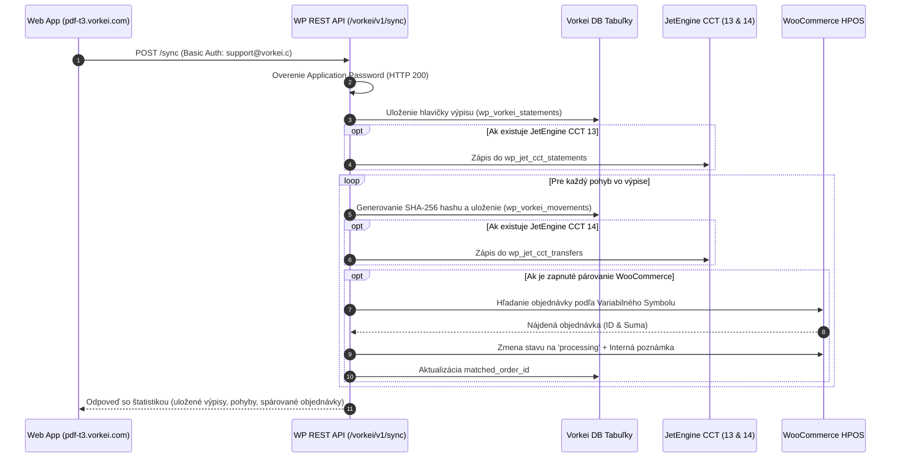

# 🧠 SOURCE OF TRUTH: Vorkei Statement Bridge & PDF-T3

Dokument slúži ako centrálna technická dokumentácia a referenčná príručka projektu prepojenia bankových výpisov Tatra banky s WordPressom.

---

## 📌 Rýchly Prehľad Kľúčových Parametrov

| Parameter | Hodnota |
| :--- | :--- |
| **Produkčná URL webu** | `https://pdf-t3.vorkei.com` |
| **WordPress REST API** | `https://pdf-t3.vorkei.com/wp-json/` |
| **API Používateľ** | `support@vorkei.c` *(ID 1, Administrator)* |
| **Aplikačné heslo (App Password)** | `7fv8 7JAG XPcc IpDk b6dn BgMk` |
| **Aktualizačný server (Auto-Updates)** | `https://pdf-t3.vorkei.com/wp-json/vorkei/v1/update-check` *(fallback: `https://api.vorkei.com/plugins/update-check`)* |
| **Inštalačný ZIP pluginu** | `vorkei-statement-bridge.zip` (280 kB, 100% PclZip safe) |
| **Testovacia pyramída** | 11/11 Úrovní úspešných (PASS) |

---

## 🛠️ Architektúra Pluginu (`vorkei-statement-bridge`)

```text
vorkei-statement-bridge/
├── vorkei-statement-bridge.php      # Hlavný zavádzač, HPOS deklarácia, Singleton
├── uninstall.php                    # Čistenie databázy (s ochranou pri delete_on_uninstall=no)
├── readme.txt                       # Oficiálny WordPress formát pre katalóg a modály
├── README.md                        # Technická dokumentácia v slovenskom jazyku
├── assets/                          # Oficiálny grafický branding
│   ├── banner-772x250.jpg           # Vysoké rozlíšenie pre WordPress hlavičku
│   ├── icon-128x128.png             # Ikona 1x
│   ├── icon-256x256.png             # Ikona 2x retina
│   └── icon.svg                     # Vektorový zdroj ikony
├── includes/
│   ├── class-vorkei-activator.php   # Vytváranie tabuliek cez dbDelta, migrácie schémy
│   ├── class-vorkei-deactivator.php # Bezpečná deaktivácia
│   ├── class-vorkei-matcher.php     # Párovanie WooCommerce platieb, auditné poznámky
│   ├── class-vorkei-rest-controller.php # REST API (/sync, /statements, /movements, /update-check, CCT 13 & 14)
│   └── class-vorkei-updater.php     # Auto-update klient pre update-check server
├── admin/
│   ├── class-vorkei-admin.php       # Administračné menu, prehľad výpisov, nastavenia
│   └── css/vorkei-admin.css         # Špeciálne štýly administračného rozhrania
└── languages/
    └── vorkei-bridge.pot            # Šablóna pre preklady
```

---

## 🔄 Synchronizačný Cyklus (Dátový Tok)



---

## 🚀 Postup Inštalácie a Prvého Spustenia

1. Otvorte administráciu WordPress na **`https://pdf-t3.vorkei.com/wp-admin/`**.
2. Prejdite do **Pluginy ➔ Pridať nový ➔ Nahrať plugin**.
3. Nahrajte súbor [`vorkei-statement-bridge.zip`](file:///home/vorkei/Documents/pdf-t3-vorkei/vorkei-statement-bridge.zip) a kliknite na **Aktivovať**.
4. V bočnom menu pribudne položka **Vorkei Bridge**:
   - **Prehľad a Výpisy**: Zobrazuje štatistiky a posledné importované bankové transakcie.
   - **Nastavenia**: Pravidlá párovania platieb, cieľový stav objednávky, nastavenie Auto-Updates.
5. V aplikácii Výpis (frontend) otvorte okno synchronizácie a kliknite na **"Otestovať spojenie"** – spojenie s `https://pdf-t3.vorkei.com` prebehne okamžite a bezpečne.

---

## 🌐 Landing Page & Prezentácia Pluginu na WordPress CMS

Prezentácia a komerčný predaj pluginu `Vorkei Statement Bridge` sú nasadené priamo vo **WordPress CMS** na produkčnej doméne **`https://pdf-t3.vorkei.com/`**:

1. **Umiestnenie a Dizajn:**
   - URL: **`https://pdf-t3.vorkei.com/`** (oficiálna úvodná stránka webu v CMS, Page ID: 10, template `landing-canvas`).
   - Štýl: **Enterprise Minimal Design Tokens na čistom bielom pozadí** (bez tmavomodrého pozadia, s dôrazom na čistú typografiu, jemné sivé orámovania a prehľadnosť).
   - Očista aplikácie (Prísny zákaz): Všetky marketingové a propagačné prvky, tlačidlá "Prezentácia Pluginu", "Landing Page" a príslušné navigačné odkazy boli striktne a trvalo odstránené z bežiacej aplikácie (WelcomeScreen a VypisApp). Bežiaca aplikácia slúži výhradne na správu a editáciu výpisov Tatra banky a je 100% čistá.

2. **Funkcionalita na Live Webe:**
   - **Živý interaktívny simulátor párovania** platby s WooCommerce objednávkou #1042 (stav `Pending payment` ➔ `Processing`).
   - **Diagnostický test živého REST API endpointu** `https://pdf-t3.vorkei.com/wp-json/vorkei/v1/statements`.
   - **Priame stiahnutie inštalačného balíčka pluginu** z WordPress Media Library: `https://pdf-t3.vorkei.com/wp-content/uploads/2026/10/vorkei-statement-bridge.zip`.
   - **Porovnanie riešení**, 6 pilierov technickej architektúry, cenové balíčky (Single, Agency, Enterprise) a interaktívny FAQ akordeón.
   - **Nasadzovací skript:** [`scripts/deploy-landing-wp.py`](file:///home/vorkei/Documents/pdf-t3-vorkei/scripts/deploy-landing-wp.py) – automatizuje správu a aktualizáciu stránky cez WordPress REST API.

