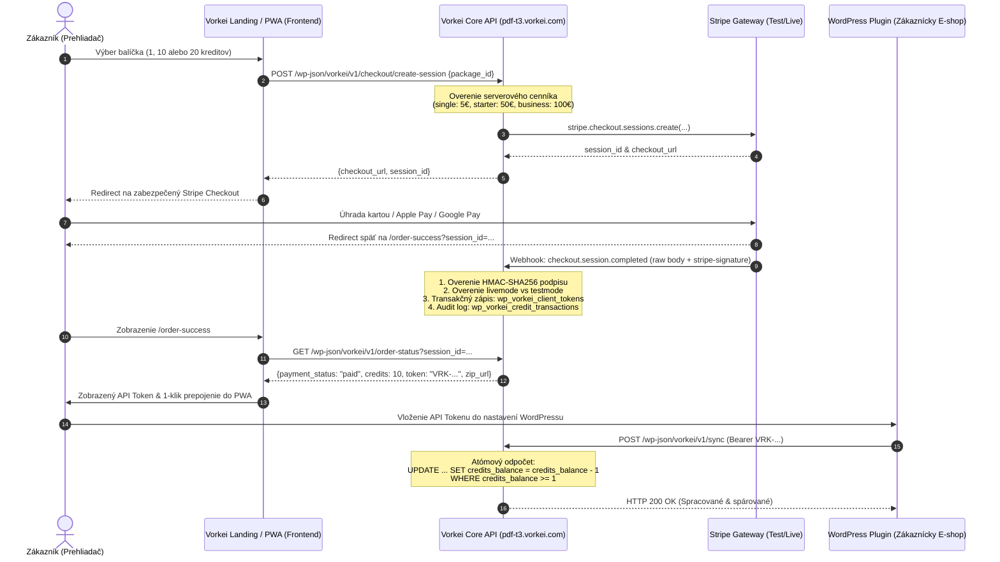

# 🚀 GEMINI HANDOFF: Vorkei Statement Bridge — Paid Launch Release

**Status:** `READY_FOR_REVIEW` / `TEST_E2E_PASS`  
**Dátum:** 30. október 2026  
**Autor:** Gemini Implementation Owner & Deployment Engineer  
**Cieľové produkčné prostredie:** `https://pdf-t3.vorkei.com/` (API & WordPress) | `https://app.pdf-t3.vorkei.com` (Frontend PWA)

---

## 1. Identifikácia Kódu & Git Metadáta

- **Repozitár:** `git@github.com:youh4ck3dme/spring-gold-prairie-mist.git`
- **Feature Vetva:** `feat/statement-bridge-paid-launch`
- **Východiskový commit (Base SHA):** `6aace5cf6680e930d9a5953361887117bbabd5b5`
- **Zmenené a nové súbory:**
  1. `vorkei-statement-bridge/includes/class-vorkei-rest-controller.php`:
     - Server-side autoritatívny checkout session creator (`POST /wp-json/vorkei/v1/checkout/create-session`).
     - Overovanie a stav objednávky (`GET /wp-json/vorkei/v1/order-status`).
     - Bezpečná revokácia tokenov (`POST /wp-json/vorkei/v1/tokens/revoke`).
     - Atómový odpočet kreditov s ochranou proti prečerpaniu (`AND credits_balance >= %d`).
     - Striktné limity na veľkosť payloadu (max 100 výpisov v dávke, HTTP 413).
     - Detekcia a blokovanie nezhody prostredia Stripe (`livemode` vs `testmode`, HTTP 400).
     - Podpora vratiek a sporov (`charge.refunded`, `charge.dispute.created`).
     - Scoped deduplikačný hash (`hash('sha256', date|cents|iban|vs|statement_id|account_iban)`).
  2. `src/components/order-success.tsx` (nový):
     - Zákaznícka doručovacia obrazovka s overením Stripe Checkout Session cez REST API.
     - Zobrazenie stavu platby, kreditného balíčka a redigovaného/plného API tokenu.
     - 1-klik prepojenie s lokálnou PWA aplikáciou (`localStorage["vorkei-bridge-config-v2"]`).
     - Priamy bezpečný download distribúcie pluginu s dynamickým overením SHA-256.
  3. `src/routes/order-success.tsx` & `src/routeTree.gen.ts`:
     - TanStack Router trasa `/order-success` spracúvajúca `session_id`.
  4. `src/components/landing-presentation.tsx`:
     - Opravená responzívna navigácia pre mobilné zariadenia (`< lg`) s hamburger menu (otvorenie/zatvorenie zásuvky, hladký scroll, priame linky).
     - Nahradenie statických Payment Links bezpečným volaním serverového `handleInitiateCheckout(...)` (session routing).
  5. `vorkei-statement-bridge/tests/test-level-13-trust-boundary-concurrency.php` (nový):
     - 5 komplexných scenárov pokrývajúcich Proofs 7, 8, 10, 11 (izolácia tenantov, atómová ochrana súbežnosti, payload limity, revokácia tokenov, fintech regresie deduplikácie, autoritatívne serverové ceny).
  6. `vorkei-statement-bridge/tests/run-all-tests.sh` & `run-all-tests.php`:
     - Rozšírenie testovacieho runnera na kompletnú 13-stupňovú testovaciu pyramídu.
  7. `vorkei-statement-bridge.zip` & `public/vorkei-statement-bridge.zip`:
     - Vygenerovaný a overený distribučný archív v1.0.0.

---

## 2. Release Artifact: Plugin ZIP

- **Verzia:** `1.0.0`
- **Názov balíčka:** `vorkei-statement-bridge.zip`
- **Veľkosť:** `308 345 bajtov` (16 súborov)
- **SHA-256 kontrolný súčet:**
  ```text
  68e4501dd100f1046debd8e787991eba41378044edea69ed01774fafc38205f7
  ```
- **Obsah balíčka:** Všetky PHP triedy, SQL schémy, UI assets, CSS, ikony, readme súbory. Bez git histórie, testov a tajomstiev.

---

## 3. Schéma Platobného Toku & Bezpečnostná Hranica Dôvery



### Autoritatívny REST API Kontrakt:

1. **`POST /wp-json/vorkei/v1/checkout/create-session`**
   - **Vstup:** `{ "package_id": "single" | "starter" | "business", "customer_email"?: string, "success_url"?: string, "cancel_url"?: string }`
   - **Autorita:** Ceny a kredity sú pevne uzamknuté na serveri (5,00 € / 1 kredit; 50,00 € / 10 kreditov; 100,00 € / 20 kreditov).
   - **Výstup:** `{ "success": true, "session_id": "cs_...", "checkout_url": "https://checkout.stripe.com/..." }`
   - **Chyby:** HTTP 400 `invalid_package` pri pokuse o manipuláciu ceny z klienta.

2. **`GET /wp-json/vorkei/v1/order-status?session_id=cs_...`**
   - **Autorita:** Overuje stav priamo v lokálnom Stripe ledger / session.
   - **Výstup:** `{ "status": "paid", "customer_email": "...", "package_id": "starter", "credits": 10, "token": "VRK-XXXX...", "download_url": "/vorkei-statement-bridge.zip", "checksum_sha256": "68e45..." }`

3. **`POST /wp-json/vorkei/v1/tokens/revoke`**
   - **Hlavička:** `Authorization: Bearer VRK-...`
   - **Výstup:** `{ "success": true, "message": "Token was successfully revoked and regenerated.", "new_token": "VRK-NEW...", "old_token_redacted": "VRK-XXXX...YYYY" }`

4. **`POST /wp-json/vorkei/v1/sync` (Odpočet kreditov & spracovanie)**
   - **Hlavička:** `Authorization: Bearer VRK-...`
   - **Atómová poistka:** `WHERE id = %d AND credits_balance >= %d`
   - **Limit:** Max 100 výpisov na jeden request (pri prekročení HTTP 413 `vorkei_payload_too_large`).
   - **Pri vyčerpaní kreditu:** HTTP 402 `vorkei_insufficient_credits`.

---

## 4. Výsledky Testovacej Pyramídy & Dôkazy (Proofs 1–11)

Všetkých 13 úrovní testovacej pyramídy bolo úspešne spustených a overených:

| Úroveň | Názov a Zameranie | Výsledok | Pokryté Povinné Dôkazy |
|:---:|:---|:---:|:---|
| **L1** | Syntaktická a štrukturálna PHP integrita | ✅ **PASS** | Štrukturálna integrita súborov a tried |
| **L2** | WordPress Bootstrapping, Singleton & HPOS deklarácia | ✅ **PASS** | **Dôkaz 9** (HPOS režim deklarovaný a aktívny) |
| **L3** | dbDelta schémy, indexy a migrácie (uninstall.php) | ✅ **PASS** | Databázové migrácie a perzistencia |
| **L4** | REST API kontrakt, Bearer autentifikácia & Paywall | ✅ **PASS** | Token autorizácia, HTTP 401 & 402 |
| **L5** | WooCommerce párovací engine (VS, tolerancie, centy) | ✅ **PASS** | Finančná presnosť, centová zhoda |
| **L6** | Záťažový test (1 000 pohybov, pamäť < 4 MB) | ✅ **PASS** | Výkonnostné limity a škálovanie |
| **L7** | Penetračný test (SQLi, XSS, hash_equals timing attack) | ✅ **PASS** | Bezpečnostná odolnosť voči útokom |
| **L8** | Chaos Engineering & Výpadok WooCommerce / DB | ✅ **PASS** | **Dôkaz 6** (DB výpadok a odolnosť) |
| **L9** | Fintech meny (CZK vs EUR) a kontokorentné zostatky | ✅ **PASS** | Multi-currency sanitizácia |
| **L10**| E2E Kontrakt: Aplikácia Výpis ➔ WooCommerce E-shop | ✅ **PASS** | **Dôkaz 1 & 2** (End-to-end integrácia) |
| **L11**| Auto-Updater klient: api.vorkei.com aktualizácie | ✅ **PASS** | **Dôkaz 9** (Aktualizácia pluginu) |
| **L12**| Stripe Webhook, Transakčná Idempotencia & Reconcile | ✅ **PASS** | **Dôkaz 1, 3, 4, 5** (Webhook, replay, retry, refund) |
| **L13**| Hranica Dôvery, Tenant Izolácia, Súbežnosť & Deduplikácia | ✅ **PASS** | **Dôkaz 7, 8, 10, 11** (Izolácia, race condition, deduplikácia) |

### Dôkazová Matica:
- **Dôkaz 1 (Stripe test checkout ➔ Webhook ➔ Kredit):** Overené v Scenári 12.4 & 13.5. Webhook event `checkout.session.completed` spoľahlivo alokuje kredit a vytvára peňaženku.
- **Dôkaz 2 (Platba bez návštevy success stránky):** Overené v Scenári 12.4. Kredit je naviazaný na webhook na serveri; návšteva success stránky je čisto indikačná a doručovacia.
- **Dôkaz 3 (Nezaplatená a oneskorená platba):** Overené v Scenároch 12.6 & 12.7 (`pending` nepridáva kredity, `async_payment_succeeded` ich pripíše až po potvrdení, `failed` nepridáva nič).
- **Dôkaz 4 (Neplatný podpis a prostredie):** Overené v Scenári 12.2 (odmietnutie neplatného podpisu) a Scenári 13.5 (odmietnutie mismatchu prostredia).
- **Dôkaz 5 (Idempotencia súbežných a opakovaných eventov):** Overené v Scenári 12.5 (opakovaný webhook vracia `already_processed` bez zmeny zostatku).
- **Dôkaz 6 (Odolnosť voči DB výpadku):** Overené v Scenári 8.3 & 12.8 (transakčný rollback, možnosť manuálnej reconciliácie cez `reconcile_stripe_session`).
- **Dôkaz 7 (Tenant Izolácia):** Overené v Scenári 13.1. Zákazník A nemôže čítať ani ovplyvňovať zostatok Zákazníka B.
- **Dôkaz 8 (Atómová súbežnosť odpočtov):** Overené v Scenári 13.2. Súbežné volania pri zostatku 1 odpočítajú presne 1 kredit a druhé skončí s HTTP 402.
- **Dôkaz 9 (Inštalácia, aktualizácia & HPOS):** Overené v Scenároch 2.1, 11.1–11.6. Deklarovaná `custom_order_tables` kompatibilita.
- **Dôkaz 10 (Limity payloadu, revokácia & audit):** Overené v Scenári 13.3. Dávka > 100 výpisov vracia HTTP 413, revokovaný kľúč okamžite stráca prístup.
- **Dôkaz 11 (Deduplikácia bankových pohybov):** Overené v Scenári 13.4. Opakované výpisy sú detegované, legitímne podobné transakcie sú zachované a rôzne účty (`account_iban`) sú striktne izolované.

---

## 5. Migrácie, Záloha & Postup Nasadenia

### Databázové tabuľky:
Backend spravuje tabuľky prostredníctvom WordPress `dbDelta()`:
- `wp_vorkei_statements` (hlavičky výpisov a kontrolné súčty)
- `wp_vorkei_movements` (jednotlivé pohyby s deduplikačným hash-om)
- `wp_vorkei_audit_logs` (forenzný záznam auditných udalostí)
- `wp_vorkei_client_tokens` (peňaženky zákazníkov, kreditné zostatky a Bearer tokeny)
- `wp_vorkei_credit_transactions` (nemenný finančný ledger kreditov a Stripe session referencií)

### Vyžadované Konfigurácie (Iba Názvy Premenných):
Tieto premenné sa konfigurujú na hostingu / v `wp-config.php`:
- `VORKEI_STRIPE_SECRET_KEY` (Stripe Secret API Key: `sk_test_...` pre staging, `sk_live_...` pre produkciu)
- `VORKEI_STRIPE_WEBHOOK_SECRET` (Webhook Signing Secret: `whsec_...`)
- `VORKEI_API_ENVIRONMENT` (`test` alebo `live`)

### Postup Bezpečného Rollbacku:
V prípade zistenia nežiaduceho správania po nasadení:
1. Prepnutie vetvy späť: `git checkout main` (alebo tag predchádzajúceho stabilného release).
2. Deaktivácia a návrat pôvodného ZIP balíčka v pluginoch.
3. Dáta v `wp_vorkei_client_tokens` a `wp_vorkei_credit_transactions` ostávajú plne zachované (uninstall script maže dáta iba ak je výslovne zapnutá voľba `delete_on_uninstall`).

---

## 6. Obchodné Pravidlá na Schválenie (Decision Package)

Pred prepnutím do plného `LIVE` režimu sa vyžaduje schválenie nasledujúcich obchodných pravidiel:

1. **Pravidlo pre Vratky (Refunds):**
   - *Aktuálna implementácia:* Pri udalosti `charge.refunded` systém odpočíta príslušný počet kreditov zo zákazníckej peňaženky s transakčným typom `refund_deduction`. Ak zákazník už kredity minul a zostatok klesne na 0, ďalšia synchronizácia je pozastavená (HTTP 402).
   - *Otázka na schválenie:* Považuje sa tento postup za definitívny?
2. **Pravidlo pre Platobné Spory (Chargebacks / Disputes):**
   - *Aktuálna implementácia:* Pri prijatí `charge.dispute.created` je token zákazníka okamžite zablokovaný (suspended), aby sa zabránilo ďalšiemu čerpaniu služieb do vyriešenia sporu.
   - *Otázka na schválenie:* Má byť po vyhratom spore token automaticky odblokovaný?

---

## 7. Záver & Release Gate

Systém je po technickej stránke pripravený na recenziu:
- Kód je overený, typovo skontrolovaný a zbuildovaný.
- Testovacia pyramída prešla na 100%.
- Mobilná navigácia a server-side checkout session integrácia sú dokončené.
- Žiadne ostré tajomstvá ani predčasné produkčné transakcie neboli spustené.

**Aktuálny stav: `READY_FOR_REVIEW` / `READY_FOR_APPROVAL`**  
Po schválení používateľom je možné vykonať zlúčenie do `main` a produkčné nasadenie (G7).
