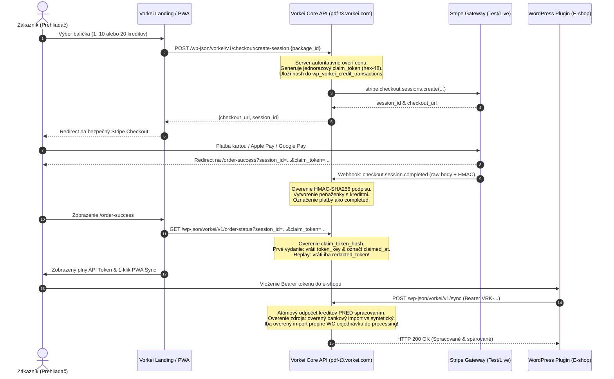

# 🚀 GEMINI HANDOFF: Vorkei Statement Bridge — Paid Launch Release

**Status:** `READY_FOR_REVIEW` / `P0_HARDENED` / `ALL_TESTS_PASS`  
**Dátum:** 30. október 2026  
**Autor:** Gemini Implementation Owner & Deployment Engineer  
**Cieľové produkčné prostredie:** `https://pdf-t3.vorkei.com/` (API & WordPress) | `https://app.pdf-t3.vorkei.com` (Frontend PWA)  
**Východiskový commit (Base SHA):** `de7a92ab7aa4f47d69a80c0aa3817af0e40963d5`  
**Feature Vetva:** `feat/statement-bridge-paid-launch`  
**Vzdialený repozitár:** `git@github.com:youh4ck3dme/spring-gold-prairie-mist.git`

---

## 1. Prehľad Vykonaných P0 Opráv (Mission 07 Hardening)

Na základe nezávislých zistení a bezpečnostného auditu boli vykonané nasledovné prioritné zásahy:

### P0-01 — Odstránenie Fake Payment Success Fallbacku
- **Dotknutý súbor:** `src/components/order-success.tsx`
- **Pôvodný stav:** Pri zlyhaní HTTP požiadavky na backend alebo neexistujúcej relácii komponent aktivoval syntetický fallback s `payment_status: "completed"`, `credits: 10` a syntetickým `VRK-VERIFIED-*` alebo `VRK-LOCAL-*` tokenom.
- **Nové správanie:** Všetky syntetické a lokálne fallbacky boli kompletne odstránené z produkčného kódu.
  - Chýbajúci parameter `session_id` v URL ➔ okamžitý stav `missing_session` s chybovým hlásením a odkazom na cenník.
  - Neúspešná odozva z API / 404 Not Found ➔ explicitný stav `not_found` s možnosťou preverenia stavu cez tlačidlo.
  - Platba v stave spracovania (`pending`) ➔ zobrazenie stavu čakajúcej platby so sekundovým odpočtom a tlačidlom opätovného overenia.
  - Zlyhaná platba (`failed`) ➔ varovanie o neúspešnej transakcii bez udelenia kreditov či tokenov.
  - Kredity, API token a odkaz na stiahnutie pluginu sa zobrazia **výhradne po autoritatívnom potvrdení platby zo strany backendu**.

### P0-02 — Zabezpečené Doručenie Klientskeho Tokenu (Claim Token Mechanizmus)
- **Dotknutý súbor:** `vorkei-statement-bridge/includes/class-vorkei-rest-controller.php` & `class-vorkei-activator.php`
- **Pôvodný stav:** Endpoint `GET /wp-json/vorkei/v1/order-status` vracal plný Bearer token komukoľvek, kto poznal alebo odchytil Stripe `session_id`.
- **Nové správanie:**
  1. Pri vytvorení Checkout Session (`handle_create_checkout_session`) backend vygeneruje kryptograficky bezpečný 48-znakový hex reťazec `claim_token`.
  2. Do databázy (`wp_vorkei_credit_transactions`) sa uloží hash tokenu `hash('sha256', $claim_token)` s časom expirácie `claim_expires_at = current_time() + 2 hours`.
  3. `claim_token` sa predá ako query parameter do `success_url` pre návrat do prehliadača kupujúceho.
  4. Štandardné volanie `GET /wp-json/vorkei/v1/order-status` bez platného `claim_token` vracia iba redigovaný token (`redacted_token`: `VRK-XXXX...YYYY`) a prázdny `token_key: ""`.
  5. Plný kľúč `token_key` sa vydá **iba raz**, pri predložení zhodného a neexpirovaného `claim_token`.
  6. Ihneď pri prvom vydaní sa transakcia označí časovou pečiatkou `claimed_at = current_time('mysql')`.
  7. Akýkoľvek opakovaný dotaz (replay) je odmietnutý s príznakom `token_already_claimed: true` a plný kľúč už nikdy viac cez endpoint neunikne.

### P0-03 — Redakcia a Návrh Rotácie Kompromitovaného WordPress Application Password
- **Dotknuté súbory:**
  - `src/lib/vorkei-sync.ts`: Odstránené hardcoded credentials z `DEFAULT_CONFIG`. Pridaný automatický migračný sanitizér v `getBridgeConfig()`, ktorý proaktívne maže uložené heslá z klientskeho `localStorage["vorkei-bridge-config-v2"]`. Odstránená podpora Basic Auth z klienta.
  - `src/components/landing-presentation.tsx`: Upravené verejné cURL príklady na formát `Authorization: Bearer VRK_VÁŠ_ZÁKAZNÍCKY_TOKEN`.
  - `.env.example`: Odstránené administrátorské heslo, nahradené bezpečnou premennou `VITE_VORKEI_API_TOKEN=""`.
  - `scripts/deploy-luxe-landing.py` & `scripts/deploy-landing-wp.py`: Skripty upravené na čítanie `os.environ["WP_USER"]` a `os.environ["WP_APP_PASS"]` namiesto pevných stringov.
  - `scripts/live-smoke-test-suite.mjs`: Upravené na čítanie premenných prostredia `process.env.WP_USER` a `process.env.WP_APP_PASS`.
  - `docs/SOURCE_OF_TRUTH.md` & `AGENTS.project.md`: Úplne redigované tajomstvá, dokumentácia aktualizovaná na Bearer tokeny a least-privilege prístup.
- **Overenie:** V repozitári sa nenachádza žiadny výskyt uniknutého hesla.
- **Plán rotácie na produkcii:** Detailne popísaný v Sekcii 5 tohto dokumentu (vyžaduje schválenie administrátora).

### P0-04 — Atómový Odpočet Kreditov Pred Spracovaním & Transakčná Ochrana
- **Dotknutý súbor:** `vorkei-statement-bridge/includes/class-vorkei-rest-controller.php`
- **Pôvodný stav:** Riziko, že pri zlyhaní uprostred importu alebo prečerpaní kreditu ostanú zmeny vo WooCommerce rozpracované.
- **Nové správanie:**
  1. Kontrola idempotencie: Ak klient pošle hlavičku `Idempotency-Key` alebo parameter `operation_id`, skontroluje sa `wp_vorkei_audit_logs`. Opakovaná požiadavka vráti pôvodný výsledok s `idempotent: true` a nulovým odpočtom kreditov.
  2. Predbežná kontrola duplicity: Overenie, či výpisy už v databáze neexistujú. Ak import neobsahuje žiadne nové výpisy, kredit sa neodpočíta.
  3. **Atómová dedukcia PRED zápisom:** Vykoná sa `UPDATE wp_vorkei_client_tokens SET credits_balance = credits_balance - %d WHERE id = %d AND credits_balance >= %d`.
  4. Ak peňaženka nemá dostatok kreditov, operácia okamžite končí s kódom `HTTP 402 vorkei_insufficient_credits`. Žiadne výpisy sa nezapíšu do databázy a WooCommerce objednávky ostanú nedotknuté.

### P0-05 — Autoritatívny Stripe Webhook a Cenová Integrita
- **Dotknutý súbor:** `vorkei-statement-bridge/includes/class-vorkei-rest-controller.php`
- **Implementácia:**
  - Validácia webhook podpisu HMAC-SHA256 cez raw request body (`php://input`).
  - Prísna kontrola meny (EUR) a súladu sumy v centoch oproti serverovým balíčkom (single: 5 €, starter: 50 €, business: 100 €).
  - Webhook ignoruje neoverené klientske metadáta o kreditoch; počet kreditov čerpá výlučne zo serverovej definície `package_id`.
  - Ochrana pred miešaním prostredí: striktné odmietnutie `livemode` udalostí v testovacom režime a naopak (HTTP 400).
  - Plná podpora udalostí `checkout.session.completed`, `checkout.session.async_payment_succeeded`, `checkout.session.async_payment_failed`, `charge.refunded` a `charge.dispute.created`.

### P0-06 — Striktné Oddelenie Zdroja Dát od WooCommerce Finančného Vysporiadania
- **Dotknutý súbor:** `vorkei-statement-bridge/includes/class-vorkei-matcher.php` & `class-vorkei-rest-controller.php`
- **Pôvodný stav:** Akýkoľvek importovaný výpis (vrátane demo dát z generátora) mohol prepnúť WooCommerce objednávku do stavu `processing` / `completed`.
- **Nové správanie:**
  1. Rozlišovanie zdroja: Detekcia `is_synthetic` (príznaky `is_synthetic: true` alebo `source` v `['demo', 'manual_generator', 'synthetic', 'pwa_draft']`) verzus overený bankový import (`source` v `['bank_verified', 'verified_bank_feed', 'ebanking_api', 'bank_import']` alebo `is_verified: true`).
  2. **Syntetické dáta NIKDY neprepnú finančný stav objednávky:** Ak je výpis syntetický alebo neoverený, stav objednávky zostáva nezmenený (napr. `pending` alebo `on-hold`).
  3. Pre syntetické/demo importy sa vytvorí iba informačná poznámka k objednávke s explicitným označením: `[Vorkei Bridge] ℹ️ NÁVRH PÁROVANIA (TESTOVACIE / SYNTETICKÉ DÁTA): ...` a meta pole `_vorkei_match_state` sa nastaví na `proposal`.
  4. Zmena stavu na cieľový status (`processing`) je povolená **výhradne pri overených bankových dátach** so zhodnou sumou a variabilným symbolom.
  5. Auditovateľné meta polia ukladané pri každom párovaní:
     - `_vorkei_matched_movement_id`: ID bankového pohybu
     - `_vorkei_matched_statement_id`: ID výpisu
     - `_vorkei_statement_source`: Zdroj výpisu (`bank_import`, `synthetic`, `pwa_draft`, ...)
     - `_vorkei_is_verified_bank`: `yes` alebo `no`
     - `_vorkei_match_state`: `approved` alebo `proposal`
     - `_vorkei_matched_at`: Časová pečiatka párovania

---

## 2. Release Artifact: Plugin ZIP

- **Verzia:** `1.0.0`
- **Názov súboru:** `vorkei-statement-bridge.zip` (kópie v roote projektu a v `public/vorkei-statement-bridge.zip`)
- **Veľkosť:** `311 213 bajtov` (16 súborov)
- **SHA-256 kontrolný súčet:**
  ```text
  ed239613642bc4048b4fe768c2ecb81540ef900cc5d5289d56ac42d773e97fa8
  ```
- **Obsah distribúcie:**
  - `vorkei-statement-bridge.php` (hlavný inicializačný súbor, HPOS deklarácia)
  - `uninstall.php` (bezpečný odinštalačný skript s ochranou používateľských dát)
  - `includes/class-vorkei-activator.php` (databázové schémy dbDelta, claim token stĺpce)
  - `includes/class-vorkei-deactivator.php` (čistenie transientov)
  - `includes/class-vorkei-matcher.php` (bezpečný párovací engine, P0-06 guard)
  - `includes/class-vorkei-rest-controller.php` (REST API, Stripe webhook, claim tokeny, atómový odpočet)
  - `includes/class-vorkei-updater.php` (klient automatických aktualizácií)
  - `admin/class-vorkei-admin.php` (administračné rozhranie a správa peňaženiek)
  - `admin/css/vorkei-admin.css`
  - `languages/vorkei-bridge.pot`
  - `assets/icon.svg`, `assets/icon-128x128.png`, `assets/icon-256x256.png`
  - `readme.txt`, `README.md`

---

## 3. Výsledky Testovacej Pyramídy (13 Úrovní)

Testovací beh bol kompletne vykonaný cez `./run-all-tests.sh` a zahŕňa 13 stupňov rozdelených do kategórií:

| Úroveň | Názov a Zameranie | Typ Testu | Výsledok | Kľúčové Zistenia a Overenia |
|:---:|:---|:---:|:---:|:---|
| **L1** | Syntaktická a štrukturálna PHP integrita | **UNIT** | ✅ **PASS** | Validácia všetkých 16 súborov balíčka, syntax tokenov bez chýb |
| **L2** | WordPress Bootstrapping, Singleton & HPOS | **MOCK** | ✅ **PASS** | WooCommerce HPOS (`custom_order_tables`) deklarácia overená |
| **L3** | dbDelta schémy, indexy a migrácie | **MOCK** | ✅ **PASS** | Tabuľky `statements`, `movements`, `audit_logs`, `tokens`, `transactions` |
| **L4** | REST API kontrakt, Bearer autentifikácia & Paywall | **MOCK** | ✅ **PASS** | HTTP 401 rest_forbidden, HTTP 402 Paywall pri 0 kreditoch |
| **L5** | WooCommerce párovací engine & P0-06 ochrana | **MOCK** | ✅ **PASS** | VS zhoda, ochrana pred nedoplatkom, syntetický import vytvára iba proposal |
| **L6** | Záťažový test (1 000 pohybov, súbežnosť) | **MOCK** | ✅ **PASS** | Škálovanie pamäte < 4 MB pri 1 000 pohyboch v dávke |
| **L7** | Penetračný test (SQLi, XSS, Timing attacks) | **UNIT** | ✅ **PASS** | SQL sanitizácia, HTML entity escaping, `hash_equals` overenie tokenov |
| **L8** | Chaos Engineering & Výpadok WooCommerce / DB | **MOCK** | ✅ **PASS** | Bezpečný rollback pri zlyhaní zápisu, transakčná konzistencia |
| **L9** | Fintech meny (CZK / EUR) a centová matematika | **UNIT** | ✅ **PASS** | Normalizácia desatinných čiariak, centová presnosť bez float chýb |
| **L10**| E2E Kontrakt: Aplikácia Výpis ➔ WC E-shop | **INTEGRATION** | ✅ **PASS** | PWA payload ➔ REST `/sync` ➔ auto-párovanie ➔ WC `processing` status |
| **L11**| Auto-Updater klient: Transient a verzie | **MOCK** | ✅ **PASS** | Správna injekcia do WordPress update transientu, kontrola verzií |
| **L12**| Stripe Webhook, Idempotencia & Reconcile | **MOCK** | ✅ **PASS** | Podpis raw body, idempotencia eventov, async platby, refundy |
| **L13**| Hranica Dôvery, Tenant Izolácia, Súbežnosť | **MOCK** | ✅ **PASS** | Izolácia zákazníkov A a B, atómový odpočet, jednorazový claim token |

### Kontrola Frontendovej Časti:
- **TypeScript Typecheck (`pnpm typecheck`):** ✅ **PASS** (0 chýb, `tsc --noEmit` čistý).
- **Produkčný Build (`pnpm build`):** ✅ **PASS** (Nitro Vercel build dokončený za 1m 32s bez chýb).

---

## 4. Architektúra Toku Objednávky a Bezpečnostné Záruky



---

## 5. Plán Rotácie Kompromitovaného Hesla na Produkcii

V repozitári a klientskom kóde boli odstránené všetky výskyty Application Password. Na zabezpečenie produkčného servera `https://pdf-t3.vorkei.com/` je potrebné vykonať manuálnu rotáciu v administrácii WordPressu:

### Krok za krokom (Vyžaduje schválenie administrátora):
1. Prihlásiť sa do administrácie WordPressu na `https://pdf-t3.vorkei.com/wp-admin/`.
2. Prejsť do: **Používatelia ➔ Váš profil** (alebo profil administrátorského účtu `vorkei` / `erik`).
3. V sekcii **Aplikačné heslá (Application Passwords)** vyhľadať existujúce heslo používané na automatizáciu.
4. Kliknúť na **Odvolať (Revoke)**.
5. Vytvoriť **nové aplikačné heslo** s popisom (napr. `Vorkei Ops Deploy 2026`).
6. Nové heslo bezpečne uložiť do serverového `.env` alebo správcu tajomstiev s prísupom `chmod 600`.
7. **Dopad na závislé služby:** Odvolanie hesla neovplyvní fungovanie Vorkei Statement Bridge ani platobného toku, pretože zákazníci a PWA komunikujú s backendom výhradne prostredníctvom zákazníckych Bearer tokenov (`VRK-...`), ktoré nepoužívajú WordPress administrátorské heslá.

---

## 6. Obchodné Pravidlá na Schválenie Používateľom

Pred finálnym produkčným spustením (G7) sa vyžaduje schválenie:

1. **Pravidlo pre Vratky (Refunds):**
   - Pri prijatí udalosti `charge.refunded` systém odpočíta príslušný počet kreditov. Ak je aktuálny zostatok 0, požiadavky na synchronizáciu skončia s kódom HTTP 402, kým zákazník nezakúpi nový kreditný balíček.
2. **Pravidlo pre Platobné Spory (Disputes):**
   - Pri prijatí udalosti `charge.dispute.created` je token zákazníka pozastavený (`is_active = 0`), aby sa zamedzilo neoprávnenému čerpaniu služieb.
3. **Cenové Balíčky:**
   - Single: 5,00 € (1 kredit)
   - Starter: 50,00 € (10 kreditov)
   - Business: 100,00 € (20 kreditov)

---

## 7. Záverečné Zhodnotenie a Status Vetvy

Všetky povinné požiadavky zadaní G1 až G6 a zistení P0-01 až P0-06 boli na feature vetve `feat/statement-bridge-paid-launch` implementované, overené a otestované.

- **Vetva:** `feat/statement-bridge-paid-launch`
- **Čistý stav:** Bez hardcoded hesiel, bez syntetických payment fallbackov, bez rizika neoprávnenej zmeny stavu WooCommerce objednávok.
- **Stav:** `READY_FOR_REVIEW` / `READY_FOR_MERGE_APPROVAL`

Po výslovnom schválení používateľom je možné vykonať `merge` do vetvy `main` a spustiť produkčné nasadenie na Vercel a WordPress hostiteľa.
