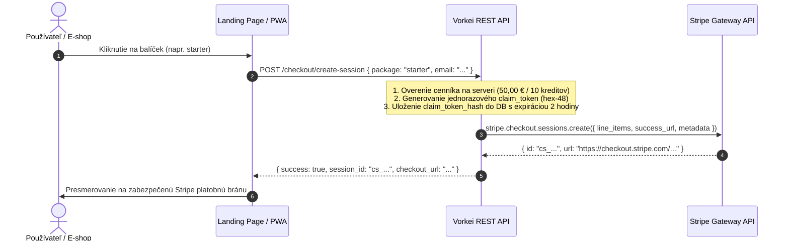
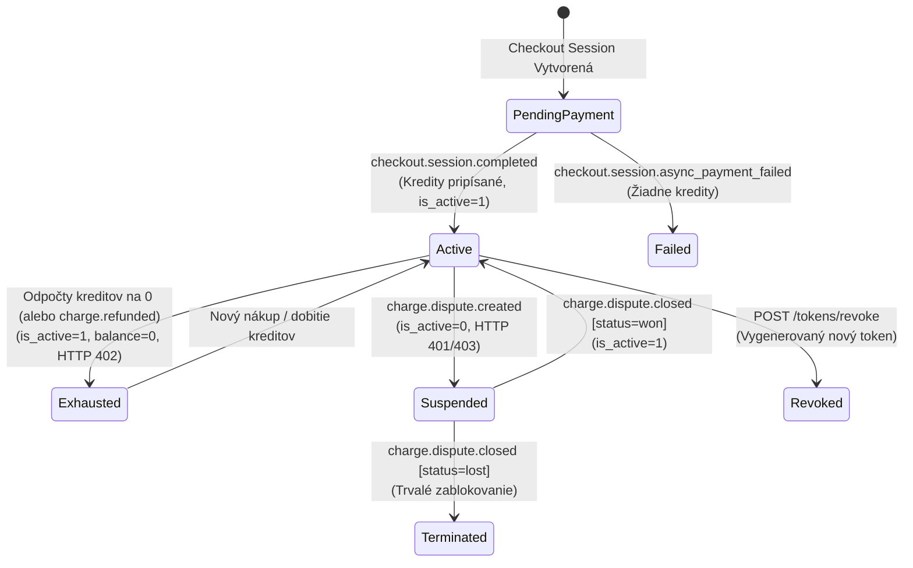

# 🏛️ BLUEPRINT: Stripe Biznis Pravidlá, Cenové Hladiny, Vratky a Spory

**Produkt:** Vorkei Statement Bridge  
**Cieľové API:** `https://pdf-t3.vorkei.com/wp-json/vorkei/v1/`  
**Dátum:** 31. október 2026  
**Status:** Schválené & Implementované (`P0_HARDENED`)  

---

## 1. Architektonický Prehľad a Základné Princípy

Integrácia platobného systému Stripe do ekosystému **Vorkei Statement Bridge** stojí na štyroch neporušiteľných princípoch:

1. **Serverová Cenová Autorita:** Klientske aplikácie (PWA, web landing, WordPress plugin) nikdy nedefinujú cenu, menu ani počet kreditov. Klient odosiela výhradne identifikátor balíčka (`package_id`).
2. **Finančná Transakčná Konzistencia (Ledger):** Každá zmena peňaženky (nákup, odpočet za výpis, vratka, spor) má prísny auditný záznam v nemennom finančnom ledgeri (`wp_vorkei_credit_transactions`).
3. **Defenzívna Bezpečnosť pri Sporoch:** Pri vzniku sporu (chargeback / dispute) má ochrana financií prednosť pred používateľským komfortom — token zákazníka je okamžite zmrazený.
4. **Idempotencia a Replay Ochrana:** Všetky webhook udalosti sú overované cez HMAC-SHA256, časové okno (max 300 s) a deduplikované podľa unikátneho `stripe_event_id`.

---

## 2. Serverovo Riadený Cenník a Tvorba Checkout Session

### 2.1 Špecifikácia Cenových Hladín

| Balíček (`package_id`) | Počet Kreditov | Suma v Centoch | Zobrazovaná Cena | Mena | Použitie / Cieľová Skupina |
|:---|:---:|:---:|:---:|:---:|:---|
| `single` | **1** | `500` | **5,00 €** | EUR | Rýchly test, jednorazový mesačný výpis |
| `starter` | **10** | `5 000` | **50,00 €** | EUR | Malé a stredné e-shopy (štandardný balík) |
| `business` | **20** | `10 000` | **100,00 €** | EUR | Vyťaženejšie e-shopy, účtovné kancelárie |

> [!IMPORTANT]
> Akékoľvek pokusy klienta o zaslanie vlastnej sumy alebo neexistujúceho `package_id` backend striktne odmieta chybou `HTTP 400 invalid_package`.

### 2.2 Endpoint `POST /wp-json/vorkei/v1/checkout/create-session`



---

## 3. Stavový Diagram Peňaženky a Klientskeho Tokenu

Každý zakúpený alebo dobitý token prechádza deterministickým stavovým automatom:



### Správanie REST API podľa stavu tokenu:
- **`Active` (Aktívny, Zostatok > 0):** Plný prístup k synchronizácii (`/sync`, `/statements`, `/movements`). Každý nový výpis atómovo odpočíta 1 kredit.
- **`Exhausted` (Zostatok = 0):** Prístup zablokovaný na úrovni paywallu kódom `HTTP 402 vorkei_insufficient_credits`. Žiadne výpisy sa neuložia a WooCommerce objednávky sa nezmenia.
- **`Suspended` (Spor / Zmrazený):** Prístup okamžite odmietnutý kódom `HTTP 401 rest_forbidden` s chybou `Token je dočasne zablokovaný z dôvodu prebiehajúceho platobného sporu`.
- **`Revoked` (Odvolaný):** Starý kľúč vracia `HTTP 401 rest_forbidden`. Prístup má iba novo vygenerovaný kľúč.

---

## 4. Spracovanie Vratiek (`charge.refunded`)

Ak dôjde k refundácii platby (či už plnej alebo čiastočnej) v Stripe Dashboarde alebo cez API:

### 4.1 Logika Spracovania
1. Stripe odošle webhook `charge.refunded`.
2. Backend overí HMAC-SHA256 podpis a vyhľadá pôvodnú transakciu v `wp_vorkei_credit_transactions` podľa `stripe_payment_intent_id`.
3. Ak bola pôvodná platba v stave `completed`, zistí sa počet pripísaných kreditov (`credits_amount`).
4. **Atómový odpočet (Clawback):**
   ```sql
   UPDATE wp_vorkei_client_tokens 
   SET credits_balance = GREATEST(0, credits_balance - %d), 
       updated_at = CURRENT_TIMESTAMP 
   WHERE id = %d;
   ```
5. Funkcia `GREATEST(0, ...)` zabraňuje vzniku nekonzistentného záporného zostatku.
6. Transakčný ledger sa aktualizuje na stav `refunded`.
7. **Dopad na používateľa:** Ak zákazník už kredity minul a zostatok klesne na 0, peňaženka prejde do stavu `Exhausted` a ďalšie pokusy o import výpisov končia s `HTTP 402 Payment Required`, kým si nezakúpi nový kreditný balíček.

---

## 5. Spracovanie Platobných Sporov (Disputes / Chargebacks)

Platobný spor nastáva, keď majiteľ platobnej karty reklamuje transakciu vo svojej banke.

### 5.1 Fáza 1: Vznik Sporu (`charge.dispute.created`)
1. Stripe doručí udalosť `charge.dispute.created`.
2. Backend dohľadá príslušný token a transakciu podľa `stripe_payment_intent_id`.
3. **Defenzívne zmrazenie:**
   ```sql
   UPDATE wp_vorkei_client_tokens 
   SET is_active = 0, 
       updated_at = CURRENT_TIMESTAMP 
   WHERE id = %d;
   ```
4. Transakcia je označená ako `disputed`.
5. Akýkoľvek ďalší REST request s daným tokenom je okamžite odmietnutý.

### 5.2 Fáza 2: Ukončenie Sporu (`charge.dispute.closed`)
Udalosť nesie pole `data.object.status`:

- **Prípad A: Vyhratý spor (`status = 'won'`):**
  - Banka uznala platnosť platby v prospech obchodníka (Vorkei).
  - Peňaženka je **automaticky odblokovaná**:
    ```sql
    UPDATE wp_vorkei_client_tokens 
    SET is_active = 1, 
        updated_at = CURRENT_TIMESTAMP 
    WHERE id = %d;
    ```
  - Stav transakcie sa vráti na `completed`.
- **Prípad B: Prehratý spor (`status = 'lost'`):**
  - Prostriedky boli strhnuté z účtu.
  - Token zostáva **zablokovaný** (`is_active = 0`).
  - Stav transakcie sa prepne na `dispute_lost`.

---

## 6. Databázová Schéma a Finančný Ledger

Všetky finančné operácie sa zaznamenávajú v tabuľkách WordPressu:

```sql
-- 1. Zákaznícke Peňaženky a Kľúče
CREATE TABLE wp_vorkei_client_tokens (
    id bigint(20) unsigned NOT NULL AUTO_INCREMENT,
    client_name varchar(191) NOT NULL DEFAULT '',
    client_email varchar(191) NOT NULL DEFAULT '',
    token_key varchar(64) NOT NULL,
    credits_balance int(11) NOT NULL DEFAULT 0,
    total_spent_cents bigint(20) NOT NULL DEFAULT 0,
    is_active tinyint(1) NOT NULL DEFAULT 1,
    created_at datetime NOT NULL DEFAULT CURRENT_TIMESTAMP,
    updated_at datetime NOT NULL DEFAULT CURRENT_TIMESTAMP ON UPDATE CURRENT_TIMESTAMP,
    PRIMARY KEY  (id),
    UNIQUE KEY token_key_idx (token_key),
    KEY email_idx (client_email)
) ENGINE=InnoDB DEFAULT CHARSET=utf8mb4;

-- 2. Nemenný Finančný Ledger Kreditných Transakcií
CREATE TABLE wp_vorkei_credit_transactions (
    id bigint(20) unsigned NOT NULL AUTO_INCREMENT,
    stripe_session_id varchar(191) NOT NULL DEFAULT '',
    stripe_payment_intent_id varchar(191) NOT NULL DEFAULT '',
    stripe_charge_id varchar(191) NOT NULL DEFAULT '',
    stripe_event_id varchar(191) NOT NULL DEFAULT '',
    package_id varchar(32) NOT NULL DEFAULT '',
    token_id bigint(20) unsigned NOT NULL DEFAULT 0,
    token_key varchar(64) NOT NULL DEFAULT '',
    customer_email varchar(191) NOT NULL DEFAULT '',
    credits_amount int(11) NOT NULL DEFAULT 0,
    amount_total bigint(20) NOT NULL DEFAULT 0,
    currency varchar(3) NOT NULL DEFAULT 'EUR',
    payment_status varchar(32) NOT NULL DEFAULT 'pending',
    claim_token_hash varchar(64) NOT NULL DEFAULT '',
    claimed_at datetime DEFAULT NULL,
    claim_expires_at datetime DEFAULT NULL,
    raw_payload longtext DEFAULT NULL,
    created_at datetime NOT NULL DEFAULT CURRENT_TIMESTAMP,
    PRIMARY KEY  (id),
    UNIQUE KEY stripe_session_idx (stripe_session_id),
    KEY stripe_pi_idx (stripe_payment_intent_id),
    KEY stripe_event_idx (stripe_event_id),
    KEY token_id_idx (token_id)
) ENGINE=InnoDB DEFAULT CHARSET=utf8mb4;
```

---

## 7. Testovacia Verifikácia v Pyramíde

Pravidlá pre cenové hladiny, vratky a spory sú pokryté automatizovanými testami v `vorkei-statement-bridge/tests/`:

- **`test-level-12-stripe-webhook.php`:**
  - `Scenár 12.1 – 12.3`: HMAC-SHA256 integrita, odmietnutie falzifikátov a ochrana pred replay útokom (> 300 s).
  - `Scenár 12.4 – 12.5`: Potvrdená platba ➔ vytvorenie peňaženky s 10 kreditmi ➔ idempotencia opakovaného volania.
  - `Scenár 12.6 – 12.7`: Oneskorené SEPA platby a zlyhané transakcie.
  - `Scenár 12.10`: **Vratka (`charge.refunded`)** ➔ odpočet 10 kreditov zo zostatku 10 na 0.
  - `Scenár 12.11`: **Platobný spor (`charge.dispute.created` & `closed: won`)** ➔ okamžité zmrazenie (`is_active = 0`) a následné obnovenie (`is_active = 1`).
- **`test-level-13-trust-boundary-concurrency.php`:**
  - `Scenár 13.2`: Atómová ochrana prečerpania zostatku (HTTP 402 pri 0 kreditoch).
  - `Scenár 13.5`: Serverový autoritatívny cenník a jednorazové vydanie tokenu cez claim token.

---

## 8. Produkčný Stripe Dashboard Operačný Manuál

Pre uvedenie do živej prevádzky je potrebné v Stripe Dashboarde nastaviť:

1. **Webhook Koncový Bod (Endpoint URL):**
   ```text
   https://pdf-t3.vorkei.com/wp-json/vorkei/v1/stripe/webhook
   ```
2. **Prihlásené Udalosti (Events to send):**
   - `checkout.session.completed`
   - `checkout.session.async_payment_succeeded`
   - `checkout.session.async_payment_failed`
   - `charge.refunded`
   - `charge.dispute.created`
   - `charge.dispute.closed`
3. **Produkčné Premenné Prostredia na Hostingu (`wp-config.php`):**
   ```php
   define( 'VORKEI_STRIPE_SECRET_KEY', 'sk_live_...' );
   define( 'VORKEI_STRIPE_WEBHOOK_SECRET', 'whsec_...' );
   define( 'VORKEI_API_ENVIRONMENT', 'live' );
   ```
4. **Manuálna Reconciliácia (Záchranná brzda):**
   V prípade sieťového výpadku medzi Stripe a serverom je možné reláciu kedykoľvek manuálne vyrovnať volaním:
   ```bash
   curl -X POST https://pdf-t3.vorkei.com/wp-json/vorkei/v1/stripe/reconcile \
     -H "Authorization: Bearer <ADMIN_TOKEN>" \
     -H "Content-Type: application/json" \
     -d '{"session_id": "cs_live_..."}'
   ```
